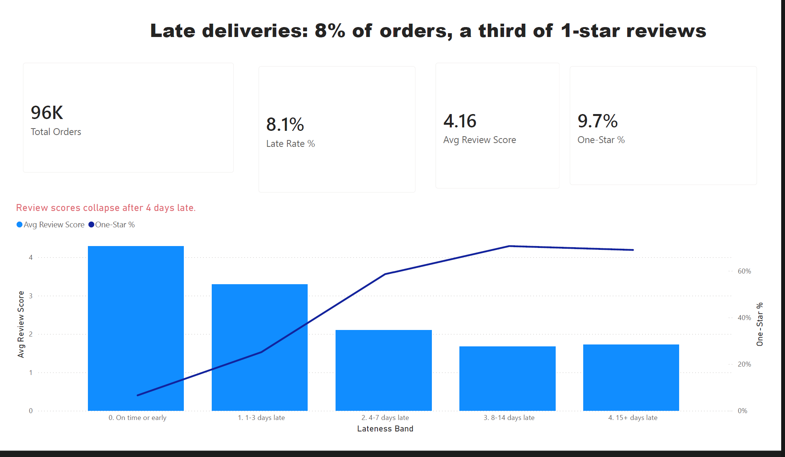
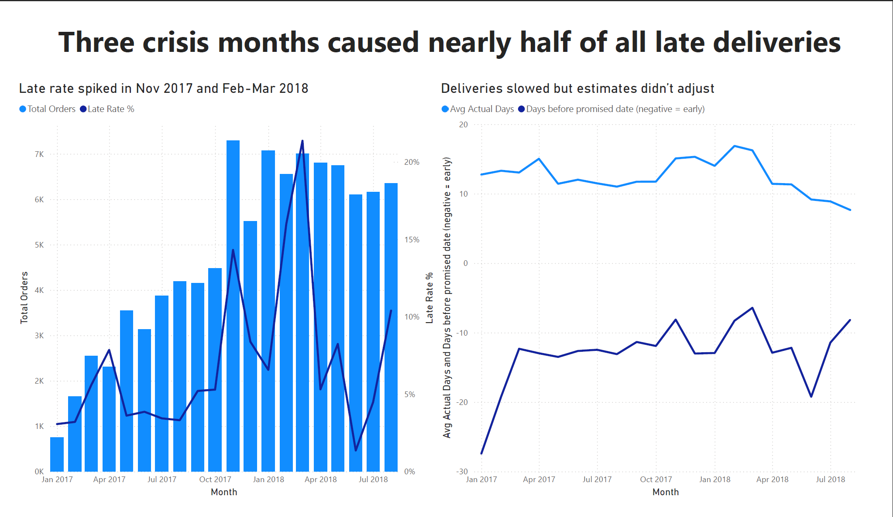
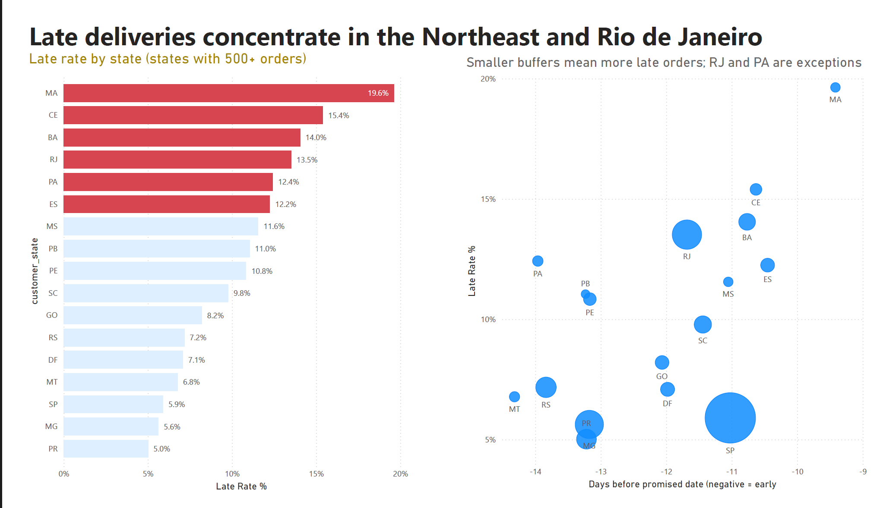

# Olist Late Delivery Analysis

**Tools:** SQL Server, Power BI
**Data:** [Olist Brazilian E-Commerce dataset](https://www.kaggle.com/datasets/olistbr/brazilian-ecommerce) (about 100k orders, 2017–2018)

## Goal

Find out how late deliveries affect customer reviews, and where the problem comes from.

## What I found

- Late orders are about 8% of all orders, but they get a big share of the 1-star reviews.
- Reviews drop sharply once an order is more than about 4 days late.
- Almost half of all late orders happened in just three months: Nov 2017, Feb 2018 and Mar 2018.
- Some regions get delivery estimates that are too short, so their orders arrive late more often.

## Recommendations

- Give longer delivery estimates during busy periods like Black Friday.
- Adjust estimates for the regions that are late most often.
- Check carrier performance in Rio de Janeiro.

## How I did it

1. Loaded the raw data into SQL Server
2. Cleaned it: kept delivered orders only, removed duplicates, checked the numbers
3. Analysed late rates by month and by region in SQL
4. Built a 3-page Power BI report

## Files

- `01_explore.sql`: first look at the data
- `02_clean.sql`: cleaning
- `03_analysis.sql`: analysis
- `list_delivery.pbix`: Power BI report
